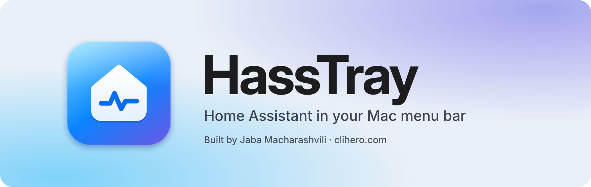
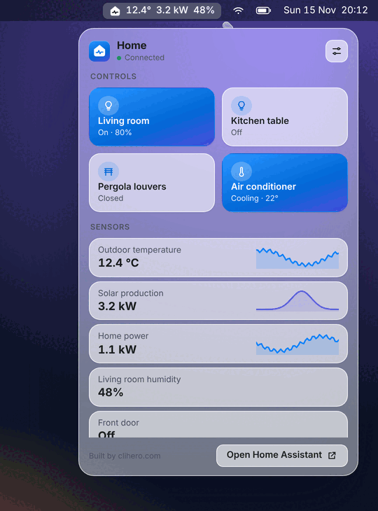
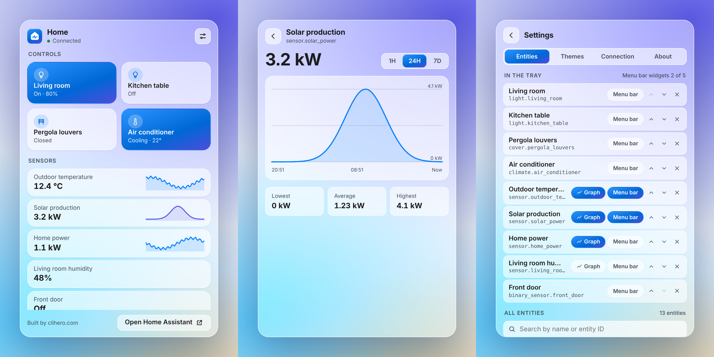
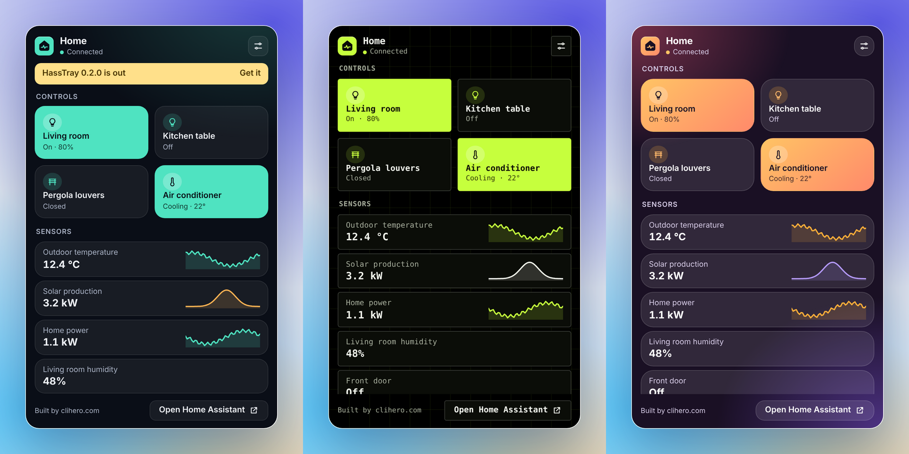

<p align="center">
  
</p>

<p align="center">
  A menu bar app for Home Assistant on macOS. Pick the entities you care about, flip them from the tray, and keep an eye on a few graphs without opening a browser tab.
</p>

<p align="center">
  
  
  
  
  
</p>

<p align="center">
  
</p>

<p align="center">
  
</p>

The demo and the screenshots use sample data.

## What it does

### The tray
Click the icon in the menu bar and a small panel drops down. Lights, switches, covers, locks, climate and media players show up as tiles you can click to toggle. Scenes, scripts and buttons run on click. Everything else is listed as a sensor with its current value.

State comes over Home Assistant's WebSocket API, so a light you switch at the wall shows up in the tray within a second or so.

### Graphs
Turn on **Graph** for any numeric entity and its row gets a sparkline of the last 24 hours. Click the row for a larger chart with 1 hour, 24 hour and 7 day ranges, the lowest, average and highest value, and a readout under the pointer.

### Menu bar widgets
Up to five entity values can sit next to the icon in the menu bar itself, for example outdoor temperature and solar output. Choose them in Settings with the **Menu bar** button on each entity. They update live and show a dash while an entity is unavailable.

### Themes

<p align="center">
  
</p>

Eight themes ship with the app, switched from Settings:

| Theme | Look |
|---|---|
| Liquid Glass | The default. Uses the macOS glass material and follows light and dark mode. |
| Midnight Mint | Dark ink with a mint accent. |
| Neon Terminal | Black, lime and monospace. |
| Sunset | Plum background with warm colours and round corners. |
| Paper | Flat, light and warm, with squarer corners. |
| Slate | Cool dark grey with a periwinkle accent. |
| Forest | Deep green with amber. |
| Rose | Pale and warm, round, with a deep rose accent. |

Under them is a mixer for making your own. Pick a theme to start from, then set the accent colour, the background, how round the corners are and the font (system, rounded, mono or serif). Changes show as you make them. The text colour, the muted colour, the card surfaces and the colour of text on top of the accent are worked out from what you pick, so a light accent on a light background stays readable.

A theme is one block of CSS variables in `frontend/dist/style.css`, so adding another preset is a short job.

### Where your data goes
HassTray talks to your Home Assistant and to nothing else, apart from one request a day to GitHub to see if a newer release exists. The access token is stored in the macOS Keychain. Your entity choices and theme are in `~/Library/Application Support/HassTray/config.json`.

## Install

There is no packaged download yet. Build it from source; it takes a couple of minutes.

You need Go and the Xcode command line tools (`xcode-select --install`).

```
git clone https://github.com/jaba0x/HassTray.git
cd HassTray
scripts/build-mac.sh 0.2.0 --install
```

That runs the tests, builds a universal `HassTray.app` (Apple Silicon and Intel), copies it to `/Applications` and starts it. Leave out `--install` to only build into `build/bin`.

To start it at login, add it under System Settings → General → Login Items.

## Set up

1. In Home Assistant, open your profile, go to the Security tab and create a long-lived access token.
2. Click the HassTray icon, enter your Home Assistant address (for example `http://homeassistant.local:8123`) and paste the token.
3. Tick the entities you want. For each one you can turn on a graph, put its value in the menu bar and move it up or down.

Right-click the icon for a short menu with Quit.

## Status

This is version 0.2.0 and it is young. What it doesn't do yet:

- Brightness, colour or temperature controls. A click toggles, and that is all.
- History beyond what Home Assistant's recorder keeps (10 days by default).
- A signed, notarized download.

It is built and tested on macOS 27 on Apple Silicon. Liquid Glass needs a recent macOS; on older versions the panel falls back to the regular frosted background.

Bug reports and ideas are welcome in the issues.

## Development

```
go test ./...
go run .
```

The interface is plain HTML, CSS and JavaScript in `frontend/dist` with no build step. To work on it in a normal browser with sample data, open `frontend/dev/preview.html`. Add `?theme=neon`, `?setup` or `?update` to see other states.

Two environment variables help when something misbehaves:

- `HASSTRAY_DEBUG=1` prints every request the panel makes.
- `HASSTRAY_DEBUG_ADDR=127.0.0.1:8177` also serves the real panel on that address, so you can open it in a browser with the developer tools.

`HASSTRAY_CONFIG_DIR` points the app at a different settings folder.

```
main.go            window, menu bar icon and menu
app.go             live state, graphs, menu bar widgets
api.go             the routes the panel calls
update.go          daily check for a newer release
internal/hass      Home Assistant client: REST, WebSocket, history, formatting
internal/config    settings file and Keychain
frontend/dist      the panel
frontend/dev       browser preview with sample data
```

The panel and the Go side talk over a handler that lives inside the app. Nothing listens on a network port unless you set `HASSTRAY_DEBUG_ADDR`.

## Author

<a href="https://clihero.com">
  <picture>
    <source media="(prefers-color-scheme: dark)" srcset="docs/clihero-logo-white.png">
    
  </picture>
</a>

Built by **Jaba Macharashvili**. More of my infra, homelab and hardware projects are on [clihero.com](https://clihero.com).

HassTray is released under the [MIT License](LICENSE). It is an independent project and is not affiliated with Home Assistant or the Open Home Foundation.

Built with [Wails](https://wails.io).
