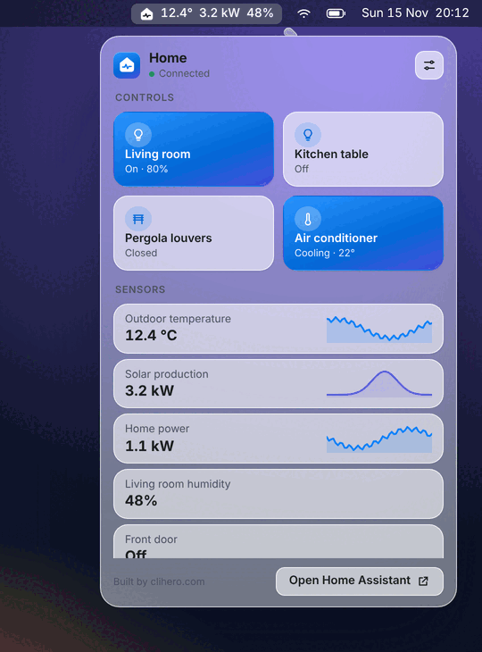

HassTray puts Home Assistant in your Mac menu bar: the entities you pick as tiles
you click to toggle, sensor rows with graphs, and up to five live values next to
the clock.

## Install

1. Download `HassTray-<version>-macos-universal.zip` below and unzip it.
2. Move `HassTray.app` to Applications.
3. **Right click the app and choose Open** the first time. The build is not
   notarized yet, so a normal double click is refused by macOS. If you prefer the
   terminal: `xattr -d com.apple.quarantine /Applications/HassTray.app`
4. Click the icon in the menu bar, enter your Home Assistant address and a
   long-lived access token (Home Assistant → your profile → Security tab).

Needs macOS 12 or newer. Universal build, Apple Silicon and Intel.

## What's in it

- Tiles for lights, switches, covers, locks, climate and media players; scenes,
  scripts and buttons run on click
- Sensor rows with a 24 hour sparkline, and a larger graph with 1 hour, 24 hour
  and 7 day ranges
- Up to five entity values in the menu bar itself
- Eight themes plus a mixer for your own colours, corners and font
- Talks only to your instance. The token lives in the macOS Keychain, and the
  one other request is a daily version check against GitHub

Full documentation and source: https://github.com/jaba0x/HassTray
Write-up: https://clihero.com/blog/hasstray-home-assistant-in-your-mac-menu-bar/

## Known gaps

A click toggles an entity, so there are no brightness, colour or temperature
controls yet. macOS only. Not notarized.
